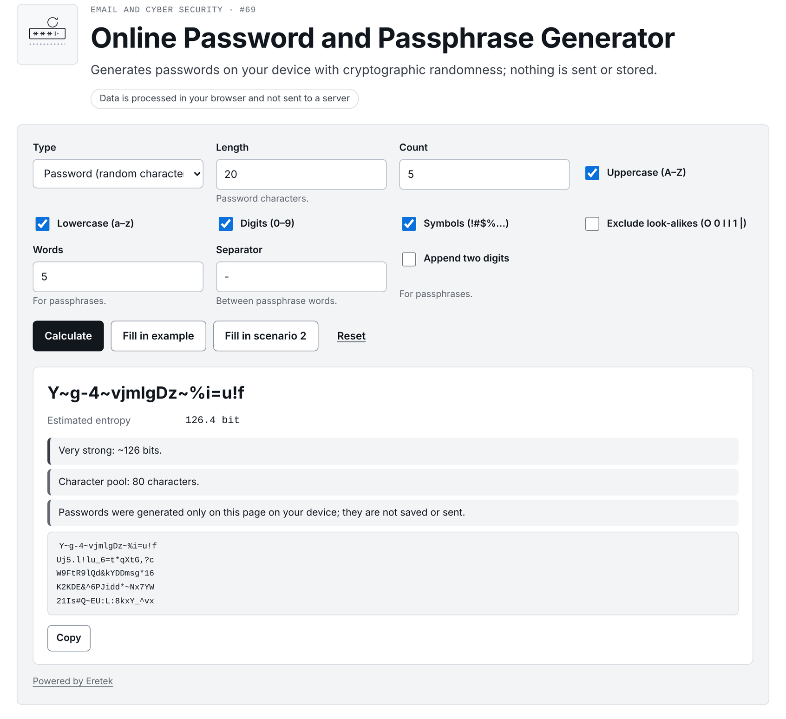

# Password and Passphrase Generator

Generate strong passwords or readable passphrases with the browser's cryptographic random generator; character sets, length and entropy in bits. Nothing is stored.

## Try it live

- [Türkçe](https://siberguvenlik.eretek.com/araclar/parola-uretici)
- [English](https://siberguvenlik.eretek.com/en/tools/password-generator)
- [Deutsch](https://siberguvenlik.eretek.com/de/werkzeuge/passwort-generator)



## What it does

Generates passwords on your device with cryptographic randomness; nothing is sent or stored.

Guessable and reused passwords are the most common cause of account takeover. The tool uses the browser's `crypto.getRandomValues` with unbiased (rejection) sampling, guarantees at least one character from each selected group and shows estimated entropy in bits.

## Where it helps

Use 24+ characters for service accounts and 5–6 word passphrases for master passwords people must remember. Use a different password per system and add MFA.

## How to use it

1. Choose password or passphrase mode.
2. For passwords set length and character groups, for passphrases the number of words and separator.
3. Press Generate; copy the value you like and store it in a password manager.

### Fields

| Field | Description |
|---|---|
| Type |  |
| Length | Password characters. |
| Count |  |
| Uppercase (A–Z) |  |
| Lowercase (a–z) |  |
| Digits (0–9) |  |
| Symbols (!#$%…) |  |
| Exclude look-alikes (O 0 I l 1 \|) |  |
| Words | For passphrases. |
| Separator | Between passphrase words. |
| Append two digits | For passphrases. |

## Example input

Press **Fill in example** in the tool to load this input.

| Input | Value |
|---|---|
| Type | `Password (random characters)` |
| Length | `20` |
| Count | `5` |
| Uppercase (A–Z) | `yes` |
| Lowercase (a–z) | `yes` |
| Digits (0–9) | `yes` |
| Symbols (!#$%…) | `yes` |
| Words | `5` |
| Separator | `-` |

**Expected result:** Five 20-character passwords from four character groups; about 126 bits of entropy each.

## Method and assumptions

Random numbers come from Web Crypto `getRandomValues`; rejection sampling avoids modulo bias. A password is regenerated until it contains at least one character from each selected group.

Entropy ≈ length × log2(character pool). Passphrase words are three syllables of 14 consonants × 5 vowels (log2(70) ≈ 6.13 bits per syllable).

## Limits and common mistakes

- Entropy is an upper bound assuming the attacker knows the method; the 'one from each group' rule lowers it slightly. Passphrase words are pronounceable syllables, not dictionary words.

## Run it locally

The tool is plain HTML, CSS and JavaScript with no build step and no dependencies.

```bash
git clone https://github.com/eretek/password-generator.git
cd password-generator
node scripts/serve.js        # or: python3 -m http.server 8080
```

Open <http://127.0.0.1:8080/>. Add `?lang=tr` or `?lang=de` for Turkish or German; without it the page follows the browser language and falls back to English. You can also open `index.html` directly from disk.

Run the tests (Node.js 18 or later):

```bash
node test/run.js    # or: npm test
```

The tests run the tool's own fixtures and the worked examples in all three languages without a browser.

## How it works

All processing happens in your browser. The tool makes no network requests, uses no cookies or browser storage, and does not upload files you select.

No server-side component is needed. The version on the Eretek website renders the same page through a private WordPress plugin; that plugin only produces the page markup and is not part of this repository.

| Path | Purpose |
|---|---|
| `index.html` | Page shell |
| `src/app.js` | Builds the page in Turkish, English or German from `src/data.js` |
| `src/data.js` | Field definitions, examples and all texts in three languages |
| `src/core.js` | Shared runtime: validation, number formats, result rendering, CSV/ICS export |
| `src/tool.js` | The calculation or analysis for this tool |
| `docs/screenshot.png` | Screenshot used in this README |
| `src/tools.css`, `src/page.css` | Styles |
| `test/run.js`, `test/cases.json` | Headless tests |

## License and attribution

This tool is released under the [Eretek Website Attribution License](LICENSE). You may use, modify and redistribute it, including commercially. If you make it available on a website or web application, show a visible, clickable credit linking to https://eretek.com/ on every page where the tool is available, for example:

```html
<a href="https://eretek.com/">Powered by Eretek</a>
```

You may add `rel="nofollow"` to the link. Keep the copyright notice and license text in copies and redistributions.
